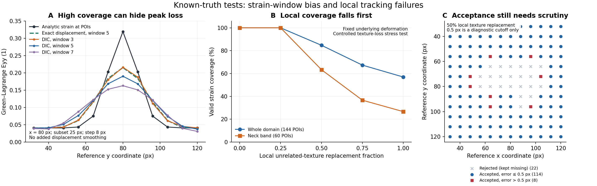

# 颈缩阶段的误差来源、可靠性修复与 VIC-2D 比较

## 本次结论

本次研究确认了三类可以分别复现的问题：有限应变窗口会削弱窄应变峰；局部仿射相关在非均匀形变下可产生很高相关系数但有偏的位移；纹理退化和重复纹理会造成缺测或错误对应。它们需要不同的诊断，单看云图、全场有效率或 ZNCC 都不能完成归因。

已实施的默认修复限于非有限条件数拒绝、多尺度初值传递、Agent 的严格收敛策略及诊断保存。扩大搜索半径有明确局部收益，也有新增错误接受，故仅保留为显式研究模式，并始终标为未通过科学质量门。默认模式在本次 14 个局部化工况中与冻结 main 的有效掩膜、共同有效点位移和应变逐点一致；本次没有宣称已经消除颈缩峰值偏差。

当前可访问材料中没有用户此次实验的原始成对图像、同条件 VIC-2D 逐点导出和完整设置。因此，下面的定量结果是已知真值的数值研究，尚不能指定用户实验中哪一种机制占主导，也不能宣称与 VIC-2D 等效。可直接用于实际数据的[逐帧比较工具与输入说明](VIC2D_COMPARISON.md)随本次修改交付。

## 代码与证据范围

基线是 2026-11-03 读取的 main，提交 `edb4fc271309fde60247858d37e57346a13c8d07`，`ezdic_core.py` SHA-256 为 `76e9096b51afa41bb8dae44715ef4027a7c9304565459cf28092faa4efc750ff`。研究版本核心 SHA-256 为 `389414c97354f6b4ee27129e994c52195b0d51ab3106ffec2492340986957fcf`。机器报告另记录研究脚本、连续纹理生成器、输入数组、逐点 CSV 和运行环境的摘要。

本次复用了现有 IC-GN/IC-LM、五阶 B 样条插值、全局特征初值、多尺度流程、空间异常拒绝和应变重建。10 月 26 日的分数子集中心与保持仿射运动的可选平滑修复，以及 10 月 30 日的正 Jacobian／应变有效性修复，都已经在 main 中，本次不重复实现。原有锁定数值门槛保持不变。

还检查了未合并的 `work/necking-jacobian-20261028` 分支，选择性复用独立局部化图像生成器与严格收敛回归，没有整体合并该分支。其历史 FIO83 记录指向当前不可访问的外部 H 盘；其中的 VIC-3D 局部引伸计与 StrainTrace 五组不同标距均值不构成同条件 VIC-2D 比较，也没有作为本次重现的实验结果。

## 怎样区分相关误差和应变重建误差

局部化试验使用独立连续 Fourier 纹理，在解析变形的逆映射上直接计算目标灰度，不使用 DIC 求解器的插值器生成目标图。轴向映射单调可逆，逆映射误差在生成器中检查。图像为 160×160，所有子集／窗口比较均锁定同一 12×12 个参考 POI：x、y 为 32、40、…、120 px。

以中心 `(80,80)` 为基准，构造位移：

\[
g(y)=\exp[-(y-80)^2/(2w^2)],\qquad
u=(\ell+n g)(x-80),
\]

\[
v=a(y-80)+p w\sqrt{\pi/2}\,\operatorname{erf}[(y-80)/(\sqrt{2}w)].
\]

窄局部化取 `a=0.04, p=0.24, w=8 px, ℓ=−0.012, n=−0.10`，既有轴向梯度，也有随位置变化的横向收缩。Green–Lagrange 应变由完整变形梯度解析计算。这是用于控制误差来源的平面制造解，没有加入真实试样的厚度变化、塑性本构或相机出平面投影。

每个工况同时保存三条结果：图像相关后重建的应变、完整真值位移经同一应变算法重建的应变，以及在实际有效支撑上使用真值位移重建的应变。后两项分别检查有限窗口偏差和缺测支撑的影响。逐点差可以分解，但这些条件诊断不是彼此独立的不确定度分量。

### 1. 满覆盖和高 ZNCC 仍可低估窄应变峰

窄局部化在子集 25 px、步长 8 px、五点窗口、额外平滑为零时，相关与应变均为 **144/144**；接受点 ZNCC 中位数为 **0.998655**。但在同一个参考点 `(80,80)`，真实 `Eyy=0.3192`，图像相关后的结果只有 **0.190238**，低估约 **40.4%**。

| 应变窗口／POI 数 | POI 中心支撑跨度／px | 名义图像支撑宽度／px | 同一点的真值位移重建 Eyy | 同一点的 DIC Eyy |
| --- | ---: | ---: | ---: | ---: |
| 3 | 16 | 41 | 0.275448 | 0.216228 |
| 5 | 32 | 57 | 0.215216 | 0.190238 |
| 7 | 48 | 73 | 0.172841 | 0.162897 |

三行真值均为 0.3192，图像与相关位移相同，变化只在应变窗口。名义图像支撑用 `subset + (window−1)×step` 描述范围，并非测得的空间分辨率。三点窗口的整场应变为 140/144：四个角点只有四个支撑点，达不到现有六点要求；颈缩带仍为 36/36。没有用插值补齐四角。

五点窗口的真值位移结果在该点损失约 32.6%，实际 DIC 再低约 0.0250。这把有限窗口影响与输入位移的额外影响分开了。全场真值位移重建的最大值为 0.215321，位置不完全相同；不能用它替换上述同一点的 0.215216。此处的真实峰沿 y=80 有并列位置，不能把某个 x 坐标当作唯一峰位置。

这组结果说明，单纯扩大应变窗口会进一步削弱窄峰。即使 `scientific_ok=true`，也只表示通过当前数值质量条件，不能保证局部峰值达到某个准确度。DIC Challenge 2.0 同样把应变空间分辨率、偏差和噪声作为独立于位移表现的评价问题；本研究提供的是 StrainTrace 在所列制造解上的直接证据。[1]

### 2. 小子集有收益，也有支撑损失

在同一网格与窄局部化图像中，子集从 25 改为 15 px，各自接受点的位移向量 RMSE 从 **0.306061** 降至 **0.132101 px**，有效相关点从 144 降为 143；只比较共同的 143 点时，RMSE 从 **0.293017** 降至 **0.132101 px**。与三点窗口组合时，应变为 **137/144**，颈缩带为 **33/36**。拒绝原因与真值误差保留在逐点表中。

因此，小子集是需要按纹理和局部梯度检验的选择，不是本次新的全局默认。该数值也不能单独证明相关求解器有代数错误：一阶仿射形函数对强曲率位移场存在模型限制。本次没有引入二阶子集形函数；在有真实局部化图像后，应先检验子集覆盖的变形范围、灰度一致性及初值，再决定是否值得承担更高阶模型的条件数与计算成本。

### 3. 局部纹理损失先破坏最需要测量的区域

在宽局部化的同一真实变形下，逐步将目标图中固定 56×56 px 区域与无关纹理混合。比例不是实验散斑脱落率，而是控制灰度对应破坏程度的参数。所有阶段保持原阈值和固定覆盖分母。

| 无关纹理混合比例 | 全场有效相关点 | 全场有效应变点 | 颈缩带有效应变点 | 原有整场质量门 |
| --- | ---: | ---: | ---: | --- |
| 0 | 144/144 | 144/144 | 60/60 | 通过 |
| 0.25 | 144/144 | 144/144 | 60/60 | 通过 |
| 0.50 | 122/144 | 122/144 | 38/60 | 未通过 |
| 0.75 | 97/144 | 97/144 | 22/60 | 未通过 |
| 1.00 | 82/144 | 82/144 | 16/60 | 未通过 |

在 0.50 工况中，22 个点被拒绝，接受点仍有 **8 个位移误差超过 0.5 px**。0.5 px 仅是此研究的描述性误差分组，不是新增接受阈值。完全落入毁损区域且满足插值缓冲要求的九个子集，在 1.00 工况中全部被拒绝；边界混合区域仍须单独审查。

严重退化时，剩余接受点的 ZNCC 中位数反而会上升，因为低质量点已从统计中移除。中心线的测得最大值可偏移到剩余支撑区域；这时不能把“剩余点中的最大值”当成原颈缩峰已被可靠定位。图中同时画出全场覆盖、颈缩带覆盖和接受点的已知误差，避免只比较保留点 RMSE。



图由 [plot_necking_study.py](../benchmarks/plot_necking_study.py) 从正式默认报告及其校验过的逐点 CSV 生成。没有补点、外推或图像后处理来改变测量值。

### 4. 固定参考策略值得继续研究，但还不能直接切换

研究另设置一个理想中间参考诊断：两条路径都给出真实材料点、真实初始位移和变形梯度；中间帧位移也精确已知，只比较最后一次局部求解并按材料坐标组合位移。在窄局部化的 `(112,80)`，固定参考总位移误差为 **0.554960 px**，理想中间参考为 **0.247953 px**；在 `(96,72)` 分别为 **0.492595** 和 **0.196054 px**。

该结果支持研究较短参考间隔，但不是已实现并验证的增量 DIC。它没有包含中间帧跟踪误差、误差累积、重参考时机、全场总变形梯度组合或失效恢复。同样的像素子集宽度在两种参考图中也覆盖不同材料区域。因此，本次不把它写成“固定参考已被证明是用户差异的根因”，也不把逐帧应变直接相加作为修复。

## 默认流程中的修复

| 修复 | 原问题 | 修改后的行为与证据 |
| --- | --- | --- |
| 非有限 Hessian 条件数拒绝 | 只判断有限且超上限，显式 `NaN/inf` 可绕过该条件 | 明确提供的非有限条件数拒绝；候选留存，发布位移／应变不可用。参数化回归检查两种非有限值 |
| 多尺度初值传递 | 粗层精修虽未通过质量检查，只要有限就可污染后续初值 | 只有通过该层检查的结果才更新初值；失败时保留上一份接受初值并正确缩放 |
| 粗层边界支持 | 粗层越界提前退出，可能将粗层坐标初值送入全分辨率 | 继续有支持的细层。已知 20 px 平移、靠左边界 ROI：旧多尺度 **12/16**，修复后 **16/16**，与单层一致；见[逐项报告](validation/necking_multiscale_boundary_20261103.json) |
| Agent 收敛策略 | pilot 和逐帧调用可继承 core 的兼容非严格默认 | pilot、计划、运行与检查点均显式 `reject_nonconverged=true`；拒绝已知未收敛结果；只重算参数不匹配的检查点 |
| 候选和质量诊断 | 被相关门拒绝的有限精修值难以追查 | 新增 `u_candidate/v_candidate/zncc_candidate`；不替换发布值；分别统计接受／拒绝的已收敛点 |

上述 20 px 平移测试使用给定的真实全局平移初值，以隔离多尺度边界与尺度传递路径；它不测试特征匹配器是否能从图像自行恢复该初值。

Agent 的旧计划需要重新 `plan` 后才能执行；缺少明确收敛策略的计划返回 `PLAN_SOLVER_POLICY_INVALID`，代码已变化的旧计划会先返回 `PLAN_STALE_CODE`。既有结果可保留读取。`verify` 不会把仅有一侧缺少策略的检查点误认为同一算法条件。历史自定义 refiner 不提供收敛状态时仍有兼容路径；内置 refiner 提供明确状态，不能将“拒绝已知未收敛”夸大为拒绝所有未知状态。

这些修改没有改变默认子集、步长、应变窗口、平滑宽度或质量门槛。空间异常拒绝仍使用原 1 px 设置，失效发布值仍为 NaN。`u_raw/v_raw` 的既有语义保持；新增候选单独命名，便于区分相关拒绝和后续空间拒绝。

## 为什么没有默认扩大搜索半径

默认 SIFT/RANSAC 全局初值会根据全局重投影残差缩小局部搜索半径。本次局部位移带中，请求半径 18 px 被缩为 3 px，导致带内只有 **5/24** 点有效；保持完整半径可以达到 **24/24**，整场从 **125/144** 增为 **144/144**。实验模式接受点的最大误差约 0.471 px，显示全局残差不能约束真实局部运动。

但更大的候选域也带来新的错误匹配。在复制散斑反例中，真实位移为 `(5,0)` px，错误副本约为 `(22,17)` px，向量误差约 **24.04 px**。真实纹理严重退化时，错误副本仍可有近 1 的相关系数：正确全局初值下，原默认拒绝中心点，而完整搜索可能接受该错误，并有 9/9 覆盖。只检查一个可精修次峰也不能保证发现全部多解。

另一次试行把次峰拒绝用于默认流程时，同图零平移覆盖从 49/49 降为 46/49，破坏原有回归。最终恢复默认策略，没有修改夹具或降低门槛。在正式 14 工况的实验研究中，小子集清洁／三点窗口／带噪三种配置分别额外拒绝 2、2、3 点，这些点在默认模式下的位移误差均不超过 0.5 px。剩余共同点位移未变，应变变化源于支撑改变。[正式三方候选报告](validation/necking_candidates_threeway_20261103.json)和[实验与默认比较](validation/experimental_vs_default_20261103.json)同时保留收益、误拒与漏检。

因此，`experimental_full_search=True` 只在直接 core 研究调用中启用完整半径与次峰检查。GUI、普通 CLI 配置和 Agent 不会自动选择它。所有实验场无论覆盖多高，均满足：

```text
quality_summary.scientific_ok = false
scientific_reasons includes "experimental_search_unvalidated"
```

实验标记写入字段、质量摘要、CSV、参数 TXT、NPZ 元数据及 NPZ 顶层标量；NPZ 载回后重算质量、再导出 CSV/NPZ 也保留此状态。14 个实验局部化工况全部未通过科学门。该限制只避免误标为通过，不能让其中的错误数值变成正确测量。

## 与 VIC-2D 的实际逐阶段比较

已提供 [compare_dic_exports.py](../benchmarks/compare_dic_exports.py)、[manifest 模板](../examples/paired_dic_comparison.json)和[详细说明](VIC2D_COMPARISON.md)。它逐帧比较同一参考坐标上的位移、局部应变、拉伸最大值与压缩最小值、极值位置、固定域覆盖、相关质量和失效位置。全 ROI 各自极值与共同有效域极值分开报告，缺测帧／点保留，质量指标不混成同一个分数。

VIC 的 `exx/eyy/exy` 列名本身不能证明其应变定义；官方文档说明默认是 Lagrange，Engineering 也不是无穷小应变。实际比较需核对总位移参考状态、坐标方向、剪切约定、单位、ROI 和各自过滤／应变参数。[2] VIC 关于比较的说明还要求区分局部应变、区域均值和标距测量；出平面运动也可能产生二维表观应变。[3]

工具要求操作者填写两侧相同的参考图／目标图 SHA-256 和设置声明，并实际计算输入 CSV、固定网格和 manifest 的摘要。它不从 CSV 独立证明原图身份或应变设置。坐标只允许至多 0.001 px 的舍入容差，不插值、不以 NaN 填补扩大共同域。结果中的 RMSE 是软件间差异，不是真值误差；报告始终 `equivalence_claim=false`。

建议首先提供均匀阶段、颈缩起始、明显颈缩、后期的原始图像与两侧完整数值导出，并保留未通过点。按如下观察顺序解释差异：

| 观测 | 优先检查 | 可以支持的判断 |
| --- | --- | --- |
| 同参考同点发布位移已分叉 | 原始与发布位移、异常／平滑策略、初值、实际搜索范围、子集灰度一致性与迭代状态 | 差异已出现在位移估计或位移处理阶段；仅改应变窗口不足以解决 |
| 位移接近，应变峰幅值差异明显 | 应变定义、窗口实际跨度、局部拟合阶数和支撑 | 后处理与空间分辨率是候选来源；需在共同支持上比较 |
| 颈缩中心大量失效，而外围仍良好 | 局部有效率、失效原因、散斑与清晰度 | 全场统计掩盖了关键区域缺测；剩余点峰值不代表原峰 |
| 不同参考策略或标距比较 | 材料坐标组合、总位移、实际测量位置 | 先恢复可比物理量，不能把不同量的差异作为软件误差 |

在实际资料到位前，不能为本实验划定“从第几帧起不可靠”的界限。可明确的边界是：局部峰宽接近测量支撑、强烈非仿射变形、重复／毁损纹理、失焦或出平面运动、关键区域缺测，以及两侧参考／应变定义不一致时，均尚无 VIC-2D 等效证据。常规阶段本次锁定回归仍可验证数值正确性，但也不替代实验标定。

## 复现与正式文件

使用仓库现有依赖，建议在独立环境安装。正式数值记录环境为 Python 3.12.14、NumPy 2.4.1、SciPy 1.17.0、OpenCV 4.13.0。输出路径应为新路径，研究程序拒绝覆盖历史证据。

```bash
git worktree add --detach ../StrainTrace-main-edb4fc2 edb4fc271309fde60247858d37e57346a13c8d07
python -m benchmarks.necking_study --core-file ../StrainTrace-main-edb4fc2/ezdic_core.py --output outputs/necking/main.json
python -m benchmarks.necking_study --output outputs/necking/default.json
python -m benchmarks.necking_study --experimental-full-search --output outputs/necking/experimental.json
python -m benchmarks.compare_necking_studies --before outputs/necking/main.json --after outputs/necking/default.json --output outputs/necking/default-vs-main.json
python -m benchmarks.compare_necking_studies --before outputs/necking/default.json --after outputs/necking/experimental.json --allow-experimental-policy-difference --output outputs/necking/experimental-vs-default.json
python -m benchmarks.necking_search_validation --core-file ../StrainTrace-main-edb4fc2/ezdic_core.py --output outputs/necking/main-search.json
python -m benchmarks.necking_search_validation --output outputs/necking/default-search.json
python -m benchmarks.necking_search_validation --experimental-full-search --output outputs/necking/experimental-search.json
python -m benchmarks.necking_candidate_validation --baseline-core ../StrainTrace-main-edb4fc2/ezdic_core.py --experimental-full-search --output outputs/necking/candidates.json
python -m benchmarks.plot_necking_study --report outputs/necking/default.json --output outputs/necking/study.png
python -m benchmarks.compare_dic_exports --manifest /path/to/real/comparison.json --output /path/to/new/comparison-results
```

| 正式证据 | 内容 |
| --- | --- |
| [main 研究](validation/main_study_20261103.json)、[逐点 CSV](validation/main_study_20261103.points.csv) | 冻结 main，14 工况 |
| [默认研究](validation/default_study_20261103.json)、[逐点 CSV](validation/default_study_20261103.points.csv) | 本次默认修复，14 工况 |
| [实验研究](validation/experimental_study_20261103.json)、[逐点 CSV](validation/experimental_study_20261103.points.csv) | 显式实验策略，14 工况，全部标记未通过 |
| [默认与 main](validation/default_vs_main_20261103.json) | 同输入、同参数、同点；有效掩膜一致，共同位移／应变最大变化均为 0 |
| [实验与默认](validation/experimental_vs_default_20261103.json) | 只允许实验开关变化，其余参数差异会拒绝比较 |
| [main 搜索](validation/necking_search_main_20261103.json)、[默认搜索](validation/necking_search_released_default_20261103.json)、[实验搜索](validation/necking_search_experimental_20261103.json) | 全局初值与局部位移带 |
| [三方候选比较](validation/necking_candidates_threeway_20261103.json) | 14 种仿射／局部带／复制散斑工况，包含错误初值与无初值 |
| [多尺度边界](validation/necking_multiscale_boundary_20261103.json) | 默认修复的 20 px 平移覆盖与误差 |

针对性回归入口：

```bash
python -m pytest -q tests/test_necking_validation.py tests/test_necking_study.py tests/test_necking_search.py tests/test_competing_dic_peaks.py tests/test_paired_dic_comparison.py tests/agent/test_strict_convergence_policy.py
python -m benchmarks.run_benchmark --output /path/to/new/locked-benchmark
```

最终代码在 Linux／Xvfb 下完成全部 701 项测试：**688 通过、13 跳过、0 失败、0 错误**；跳过项需要 Windows 或负坐标显示器条件。NPZ 往返补修后的完整套件已重新执行。原有锁定基准全部通过，数值门槛保持：小平移 RMSE 0.000242871 px、大平移 RMSE 0.000142756 px，仿射应变最大分量误差 0.0000128097。构建并安装 wheel 后，还在源码目录外实际运行了比较 CLI，核对 3/4 共同覆盖、预设 0.1 px 位移差、缺失帧保留及不宣称等效。

[机器可读回归证据](validation/necking_regression_20261103.json)记录最终代码摘要、跳过原因、测试日志摘要、锁定基准和安装检查。原有基准的质量排序指标不等于实验准确度或已经标定的不确定度；没有改动原有门槛和既有失败断言来接受算法回退。

## 外部依据

1. Reu et al., *DIC Challenge 2.0: Developing Images and Guidelines for Evaluating Accuracy and Resolution of 2D Analyses*. [NIST publication record](https://www.nist.gov/publications/dic-challenge-20-developing-images-and-guidelines-evaluating-accuracy-and-resolution-2d).
2. Correlated Solutions, [Strain Tensors and Criteria in VIC](https://correlated.kayako.com/article/2-strain-tensors-and-criteria-in-vic).
3. Correlated Solutions, [Comparing 2D DIC Data to Theory/Strain Gauges/Other Techniques](https://correlated.kayako.com/article/75-comparing-2d-dic-data-to-theory-strain-gauges-other-techniques).
